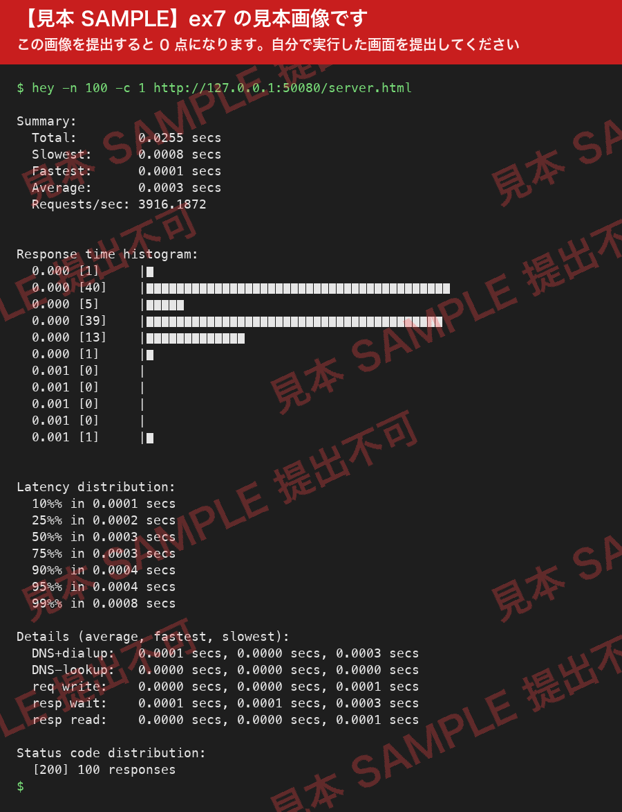

# ex7 — hey と HTTP サーバの負荷テスト

## 小テスト {: .exercise }

小テストは 4 講時の講義パートのあとに行います。問題は前回の aiJudge 課題の内容に沿っています。受験できるのは **1-608 の教室だけ**で、オンラインでは受験できません。

**16:30〜16:45** の 15 分間で、aiJudge の次の課題に取り組んでください。

<!-- aijudge:begin test7 -->
- runThread.py
<!-- aijudge:end -->

## まとめの小テストについて

最終回（11/13）の **4 講時（15:30〜16:30）**に、1-608 の実習室 PC で「まとめの小テスト」を行います。実施方法は [ex8](ex8.md) で確認してください。

## 演習課題 {: .exercise }

!!! danger "ex7 は「まとめの小テスト」のリハーサルです — 1-608 の実習室 PC の Web エディタからしか提出できません"
    ex7 の 2 つの課題は、次回（11/13）の[まとめの小テスト](ex8.md)と**同じ設定**にしてあります。当日の手順を、ここで一度試しておいてください。

    - 提出できるのは **1-608 の実習室 PC からだけ**です。自分のノート PC や、自宅など学外からは提出できません（まとめの小テストも同じです）
    - 提出は **aiJudge の Web エディタからだけ**です。実習室 PC のブラウザで aiJudge を開き、コースの画面で ex7 の見出しの下にある「エディタで解く」を押してください。課題の画面のファイル欄からは提出できません
    - エディタを開くと「画面全体を共有して始める」が表示されます。小テストと同じく「画面全体」を共有してください。**画面の共有を止めると提出できません**
    - **hey のスクリーンショット（画像）は、実習室 PC に移してから提出します。** 自分の PC で撮った画像を、OneDrive などのクラウドストレージや USB メモリで実習室 PC にコピーし、エディタの画面にある hey の課題のタブで選んで提出してください
    - 提出の締切は **11/13（金）0:00** です。それまでの間なら、1-608 の実習室 PC から何度でも提出できます

!!! tip "まとめの小テストの準備をしておきましょう"
    まとめの小テストでは、**自分のプログラムのコードを参照できます**。ただし、使えるのは実習室 PC だけです。この機会に、これまでに書いたプログラム（ex3〜ex7 の `.py` ファイルなど）を実習室 PC にコピーし、まとめの小テストでも開けるようにしておくとよいでしょう。

### 演習課題 1. hey で負荷テストを行う {: .exercise }

`hey` をインストールし、**次に示す「測ってよい相手」のどれか 1 つ**に対して Web サーバの負荷テストを行ってください。3 つすべてを測る必要はありません。迷ったら 1 の自分の PC で測ってください。

!!! danger "負荷テストの宛先は限定されています"
    この科目で負荷テストを行ってよい相手は、次の 3 つだけです。これ以外のサーバには負荷テストを行わないでください。

    1. 自分の PC で動かしている `httpServer.py` — `http://127.0.0.1:50080/server.html`
    2. 自分が管理しているサーバ — 自分で借りた VPS、自分の Raspberry Pi、同じ LAN 内の自分の PC など
    3. この科目で許可された学内サーバ — `https://www.math.ryukoku.ac.jp/` と `https://whale2.math.ryukoku.ac.jp/` の 2 つのみ

    大学の公開サイト（`www.ryukoku.ac.jp` など）、企業・公共機関・他人のサイト、学内の他の実習室や研究室のマシンは**すべて対象外**です。

!!! warning "過度な負荷テストは行わないでください"
    負荷テストと DoS 攻撃では、実行するコマンドに違いはありません。両者の違いは、相手の許可があるかどうかだけです。
    許可された相手に対しても、`-n 100` 程度から始めてください。`-n 1000` は一度くらいなら許容範囲ですが、`-n 10000` は避けてください。
    また、`-c` の既定値は 50 なので、**必ず `-c` を明示**してください。

    過去には、許可のないサーバに大量のリクエストを送り、大学から指導を受けた例があります。DoS 攻撃とみなされると、発信者個人だけでなく組織全体（たとえば龍谷大学全体）からのアクセスが拒否されることもあります。

#### hey のインストール

=== "Windows"

    1. [GitHub の hey リポジトリ](https://github.com/rakyll/hey) の README の Installation にある **Windows (amd64)** のリンクから、実行ファイルをダウンロードします
    2. ダウンロードしたファイル（`hey_windows_amd64`）の名前を `hey.exe` に変更し、作業用のフォルダに置きます
    3. PowerShell でそのフォルダに移動し、`.\hey.exe -h` で使い方が表示されることを確かめます。以降のコマンドの `hey` は `.\hey.exe` に読み替えてください

=== "macOS"

    Homebrew を使っている場合は、`brew install hey` でインストールできます（以降は `hey` で実行できます）。

    Homebrew を使っていない場合は、README の **macOS (amd64)** のリンクからダウンロードし、ターミナルで次のようにします。

    ```console
    $ mv ~/Downloads/hey_darwin_amd64 ./hey      # 名前を hey に変える
    $ chmod +x hey                               # 実行できるようにする
    $ xattr -d com.apple.quarantine hey          # 「開発元を検証できません」と止められないようにする
    $ ./hey -h                                   # 以降のコマンドの hey は ./hey に読み替える
    ```

    Apple Silicon（M1 以降）の Mac では、初回に Rosetta 2 のインストールを求められることがあります。

=== "WSL / Linux"

    Ubuntu などでは `sudo apt install hey` でインストールできます。

#### hey を実行する

1. 上記の「測ってよい相手」のどれか 1 つに対して、`hey` で負荷テストを行ってください。自分の PC で `httpServer.py` を起動し、次のように測るのがもっとも確実です。

    ```console
    $ hey -n 100 -c 1 http://127.0.0.1:50080/server.html
    ```

    - `localhost` ではなく `127.0.0.1` と書いてください。PC によっては `localhost` が IPv6 の宛先（`::1`）になり、IPv4 で待ち受けている `httpServer.py` に接続できません（`connection refused` のエラーになります）
    - 学内サーバは `https://` で指定してください。`http://` だと、`https://` への転送（リダイレクト）の分だけリクエストが余計に送られます
    - `httpServer.py` は一度に 1 つの接続しか処理しないので、`-c` を大きくすると `Error distribution` にエラーが表示されることがあります。それも測定の結果なので、そのまま提出してかまいません

2. 負荷テストを行ったターミナル画面のスクリーンショットを、次の aiJudge の課題に提出してください（画像を 1-608 の実習室 PC に移してから、Web エディタの hey のタブで）。スクリーンショットには、実行したコマンドと出力結果（Summary から Status code distribution まで）をすべて含めてください。

    実行画面は、たとえば次のようになります。**これは見本です。この画像をそのまま提出すると 0 点になります。**

    { width="600" }

<!-- aijudge:begin ex7:hey -->
- hey による負荷テストのスクリーンショット
<!-- aijudge:end -->

### 演習課題 2. スレッドをリストにためるプログラム {: .exercise }

aiJudge の次の課題に取り組んでください。

<!-- aijudge:begin ex7:threadList -->
- threadList.py
<!-- aijudge:end -->

## レポート課題（任意提出課題）

任意提出のレポート課題は、[レポート課題](report.md)のページを見てください（第 8 回の終了後から 11/27 まで提出できます）。
